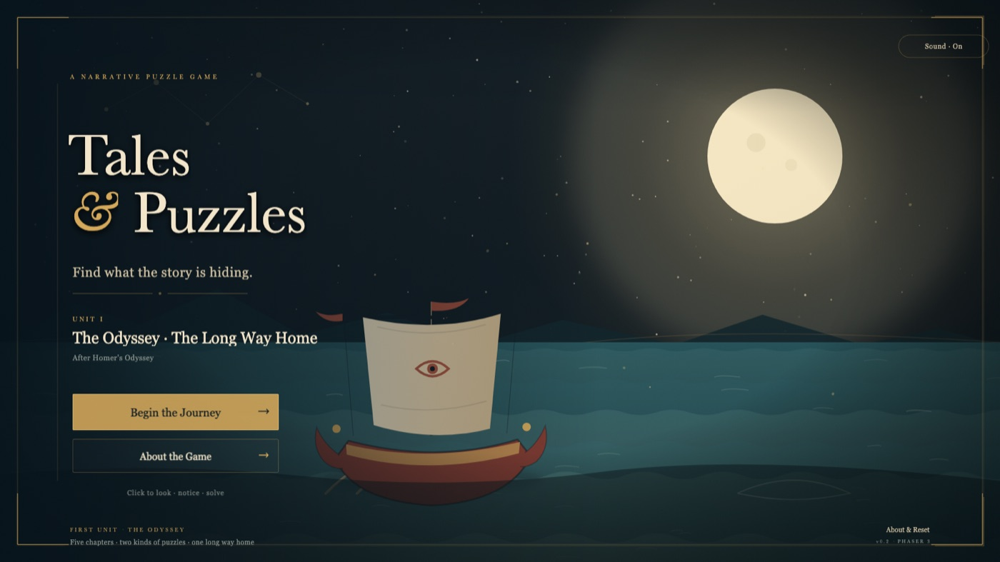
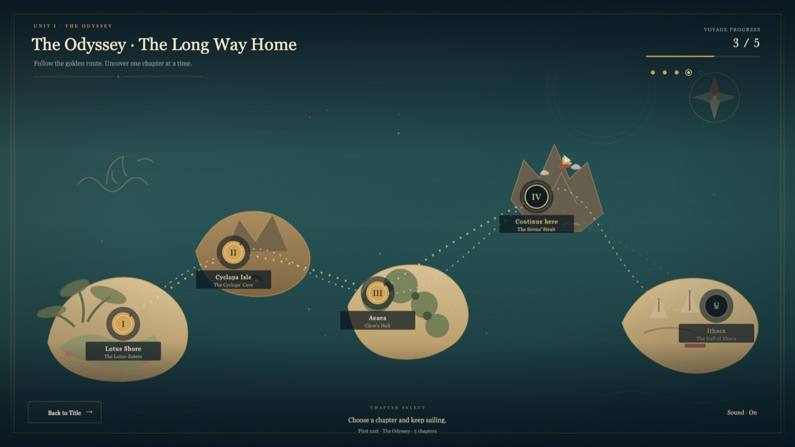
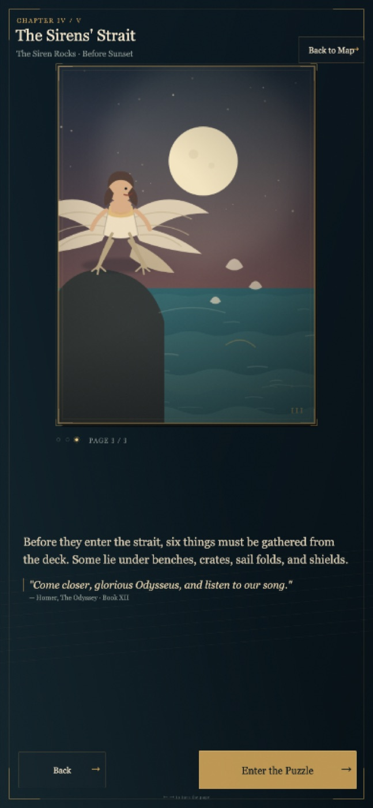
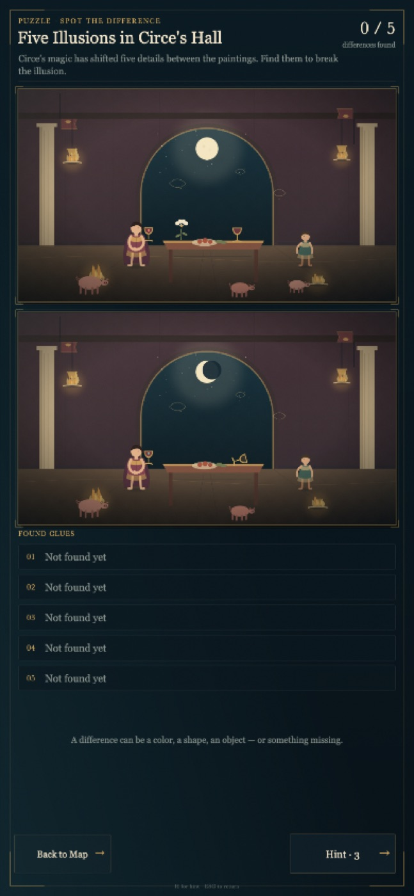
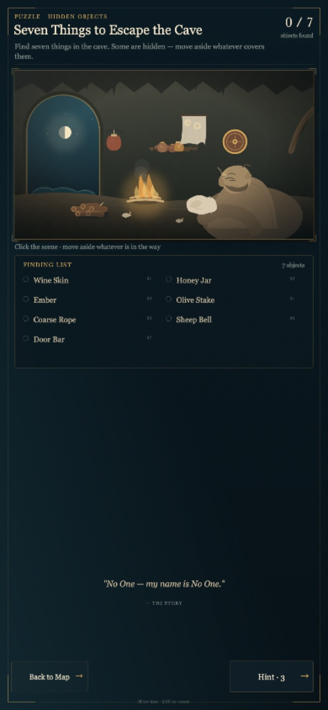
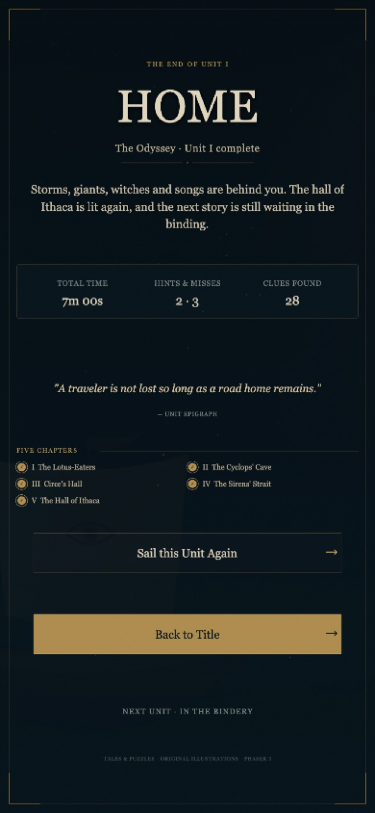
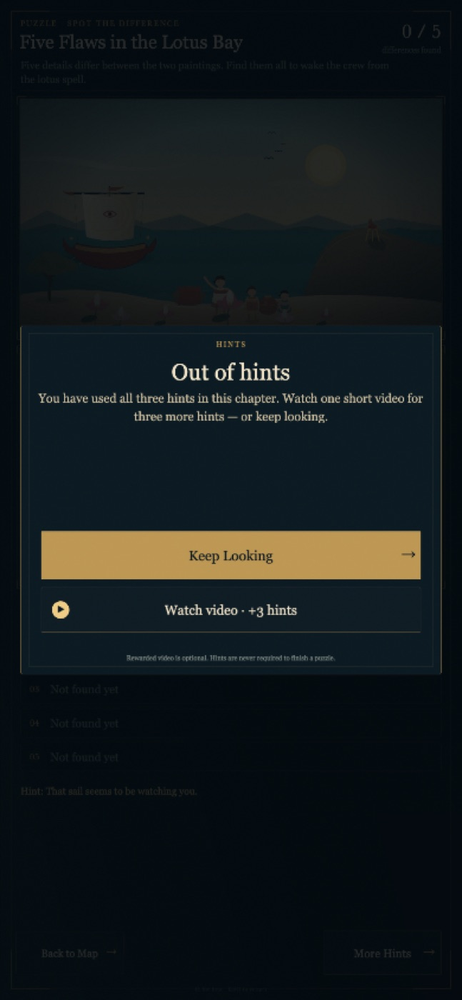

# Tales & Puzzles

> The story is the riddle. The picture is the answer.

A narrative puzzle game hidden inside great books and old legends. Each unit is a story. Each chapter opens with a three-page illustrated story: one panel and one passage per page, with page navigation. The last page hands the player one of two puzzles: **spot the difference** or **hidden objects**.

The current release is a playable vertical slice: **Unit I — The Odyssey · The Long Way Home**, in five chapters.



## Run it

Node.js 18+ is required. There is no build step and no dependency install:

```bash
npm start
```

Open <http://127.0.0.1:4173>. To use another port:

```bash
PORT=8080 npm start
```

Phaser 3.90 is vendored in `vendor/`, so the game runs fully offline. Open `index.html` through the server, not by double-clicking the file — the game uses ES modules and local SVG assets.

## What is playable

- **Five Odyssey chapters**: The Lotus-Eaters → The Cyclops’ Cave → Circe’s Hall → The Sirens’ Strait → The Hall of Ithaca.
- **Three spot-the-difference chapters** with 5 differences each.
- **Two hidden-object chapters** with 6–7 objects each. Covers can be moved aside: fire, firewood, fleece, hanging cloth, shields, a bench, a crate, and a sail fold all hide something.
- **Full flow**: title, chapter map, a three-page story reader per chapter, puzzles, completion cards, and a unit epilogue.
- **Comfort features**: three hints, miss feedback, auto-save with `localStorage`, resume, chapter replay, and a sound toggle.
- **Original vector art**: every scene, map, and story triptych is generated from the SVG toolkit in this repository. No external image assets.

| Chapter map | Story page |
| --- | --- |
|  |  |

| Spot the difference | Hidden objects |
| --- | --- |
|  |  |



## Responsive layout

The game has two purpose-built stage layouts rather than a single scaled desktop image:

- **Landscape / desktop:** a 1600 × 900 stage, scaled to fill laptops and standard widescreen monitors.
- **Portrait / phone / tablet:** a 900-unit-wide stage whose height follows the device aspect ratio. Story art stacks above the text; the two spot-the-difference paintings stack vertically; the finding list becomes a two-column panel; the map becomes a vertical chapter list. Buttons and type are sized for touch.

The CSS respects `safe-area-inset-*` on notched phones. Rotating the device rebuilds the page in the new layout; completed chapter progress is kept in local storage.

## Controls

| Input | Action |
| --- | --- |
| Click / tap | Choose, search, or move a cover |
| `H` | Use a hint |
| `←` / `→` | Turn story pages back / forward |
| `Enter` | Next story page; enter the puzzle on page 3 |
| `Esc` | Return to the chapter map |
| On-screen buttons | Back, hint, sound |

## Project structure

```text
.
├── index.html                  HTML shell, boot screen, orientation veil
├── scripts/serve.mjs           Zero-dependency static server
├── src/
│   ├── main.js                 Phaser config and scene registration
│   ├── styles.css              HTML shell, boot screen, safe-area layout
│   ├── core/
│   │   ├── viewport.js         Landscape/portrait stage dimensions
│   │   ├── monetization.js     Poki SDK adapter + local mock
│   │   ├── save.js             localStorage progress
│   │   └── audio.js            WebAudio ambience and sound effects
│   ├── data/odyssey.js         Story, levels, puzzle coordinates
│   ├── ui/
│   │   ├── theme.js            Type, colours, buttons, panels, transitions
│   │   ├── complete.js         Responsive completion overlay
│   │   ├── hintShop.js         Rewarded hint offer
│   │   └── adBreak.js          Ad curtain and break helpers
│   └── scenes/                 Title, map, story, spot, hidden, ending
├── assets/art/                 Runtime SVG files (generated)
├── tools/
│   ├── build-art.mjs           Art build entry point
│   └── art/                    SVG primitives and Odyssey scenes
├── vendor/phaser.min.js        Phaser 3.90
└── docs/screenshots/           README images
```


## Poki SDK spike

The game now has a thin Poki adapter (`src/core/monetization.js`) around the official JavaScript SDK. Phaser itself does not provide ads; Poki is the ad network and the revenue source.

The real SDK is used on Poki-owned hosts. Localhost and ordinary public review hosts use a deterministic mock; `?mockAds=0` opts into a real-SDK attempt. If the SDK is missing or fails on a real host, ads are disabled rather than granting a free reward. That keeps local and review builds playable while failing safe on the platform:

| URL | Behaviour |
| --- | --- |
| `http://127.0.0.1:4173/` | mock, no external SDK request |
| `?mockAds=1` | force local mock |
| `?mockAds=0` | force a real SDK attempt (Poki hosts do this automatically) |
| `?mockAdFail=1` | mock rewarded video returns failure, for testing the no-reward path |

Implemented flows:

- **Chapter boundary midroll:** after the completion card, `Continue Journey` calls `commercialBreak()` before opening the next chapter. `Back to Chapter Map` never triggers an ad. Poki decides whether an ad actually fills; there is no internal ad timer.
- **Rewarded hints:** after the three free hints are used, the hint button becomes `More Hints`. The offer shows a standard `Keep Looking` button above an optional `▶ Watch video · +3 hints` button. The standard button is larger; the rewarded button is not green and carries a video icon. The reward is granted only when `rewardedBreak()` resolves `true`.
- **Audio / input:** ads pause audio, block pointer input, and suppress hint/keyboard shortcuts. `gameplayStart()` / `gameplayStop()` are guarded against duplicate calls.
- **Story skip:** pages 1 and 2 have a `Skip story` link, so the cutscene can be skipped.



The full event map, local test matrix and Poki QA checklist live in [docs/poki-spike.md](docs/poki-spike.md). Upload copy and registration steps are in [docs/poki-submission.md](docs/poki-submission.md).

## WeChat Mini Game

A Cocos Creator 3.8 validation project lives in `wechat-minigame/`, with a 2D-only WeChat build and a browser-verified touch/storage spike. See [docs/wechat-cocos-spike.md](docs/wechat-cocos-spike.md).

The adapter is deliberately raw-SDK based rather than using `@poki/phaser-3`: this game has no bundler and uses multiple scenes (Title, Map, Story, Spot, Hidden, UnitEnd), so manual event boundaries are clearer than a single `gameplaySceneKey`. The official Phaser plugin remains a good option if the project later adds a bundler.

This has not yet been submitted to Poki. The next validation step is to upload a zip to the [Poki Inspector](https://inspector.poki.dev/) and confirm the event stream, ad fill, mobile/portrait behaviour, and the 16:9 requirement on the platform.

A minimal Poki build can be zipped from the runtime files only:

```bash
zip -r tales-and-puzzles-poki.zip index.html assets src vendor
```

A prepared runtime zip is included: [tales-and-puzzles-poki.zip](tales-and-puzzles-poki.zip).

Poki's hard requirements page still foregrounds a 16:9 full-canvas layout, while this build also has a phone-first portrait stage. That is the main platform risk to verify before producing the rest of the art.

## Design notes

### Data-driven levels

`src/data/odyssey.js` is the single source of truth. A chapter contains:

- `story`: chapter number, title, story-panel key, three prose paragraphs, quote;
- `puzzle.type`: `spot` or `hidden`;
- spot: two image keys plus `{ x, y, r, name, hint }` hotspots;
- hidden: item `{ x, y, r, cover }`, cover sprites and movement data, plus finding-list names.

All puzzle coordinates are written in the **1600 × 900 illustration space**, then converted to the displayed panel. This keeps desktop and portrait coordinates in sync.

### Three-page story reader

The five triptych paintings are kept as single SVG sources. At load time the game cuts each triptych into three runtime textures, so each story page can show one framed panel at full size. Page 1 has **Continue**; page 2 adds **Back** plus **Continue**; page 3 adds **Back** plus **Enter the Puzzle**. The quote appears on page 3. A dot indicator and `←` / `→` keys mirror the buttons.

### Spot the difference

Both paintings are A/B variants generated from the same scene component. A click on either painting tests the same five hotspots, marks both panels, and updates the clue cards.

### Hidden objects

The scene texture contains every object, but full-canvas transparent SVG covers hide the concealed ones. Moving a cover:

1. plays a slide/fade tween;
2. shows a short discovery message;
3. pulses the newly revealed item;
4. makes the item collectable.

### Saving

`pnp.save.v1` stores completed chapters, the current chapter, cumulative hints/misses/clues, and unit start/end times. Unlocking is derived from “all previous chapters completed”; there is no separate unlock list to maintain.

## Adding content

### A spot-the-difference chapter

Add a level in `src/data/odyssey.js`:

```js
puzzle: {
  type: 'spot',
  imageA: 'my-scene-a',
  imageB: 'my-scene-b',
  differences: [{ id: 'x', name: '...', x: 640, y: 400, r: 70, hint: '...' }]
}
```

Add the SVGs to the load list in `src/scenes/PreloadScene.js`, and add a map node in `odyssey.map.nodes`.

### A hidden-object chapter

```js
puzzle: {
  type: 'hidden',
  image: 'my-room',
  items: [{ id: 'key', name: 'Key', x: 500, y: 620, r: 55, cover: 'curtain', hint: '...' }],
  covers: [{
    id: 'curtain', x: 500, y: 580, r: 100,
    texture: 'my-room-curtain', label: 'Open the curtain',
    move: { x: 70, y: 10, alpha: 0.9 },
    message: 'A key was hidden behind the curtain.'
  }]
}
```

The `cover` field links an item to its cover. An item becomes clickable only after that cover is opened.

### Art

Illustrations live as composable SVG functions in `tools/art/`. Run:

```bash
npm run art
```

This regenerates every file in `assets/art/`. The scene generator shares one composition between each A/B spot-the-difference pair.

## Status and next steps

- [x] Five chapters, three-page story reader, two puzzle types, covers, hints, save, ending
- [x] Poki SDK adapter, local mock, rewarded hints, chapter-boundary midroll
- [x] Desktop, phone portrait, tablet portrait, touch targets, safe areas
- [x] English game copy
- [ ] Poki Inspector validation and a real SDK pass
- [ ] Second unit (for example, Arthurian legend or Dante)
- [ ] Unit selector and multi-unit save schema
- [ ] More in-chapter staging, layered ambience, accessibility options

## Credits

- Story: Homer’s *Odyssey*, public domain; all in-game prose and quotes are original adaptations.
- Art: original SVG illustrations generated in this repository.
- Engine: Phaser 3.90 (MIT).
- Type: system serif stack; no external font service.

---

**Tales & Puzzles** · a narrative puzzle experiment · Phaser 3.90
