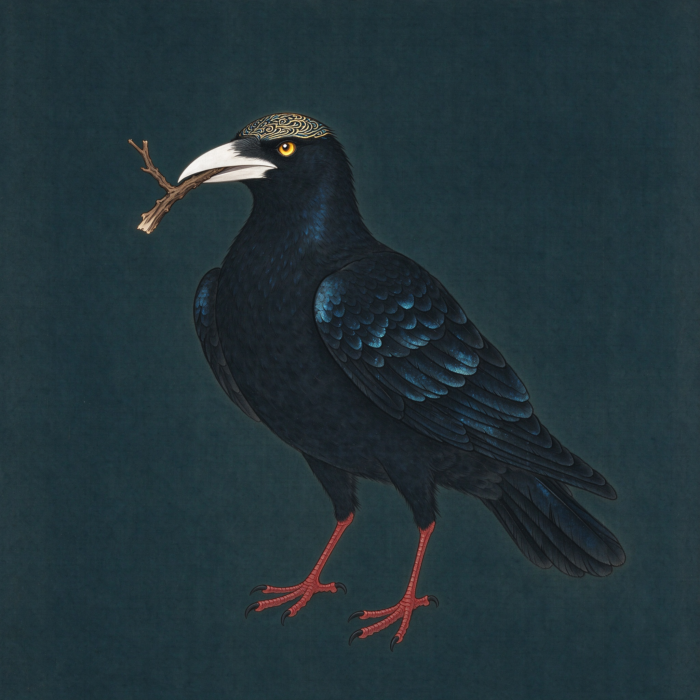
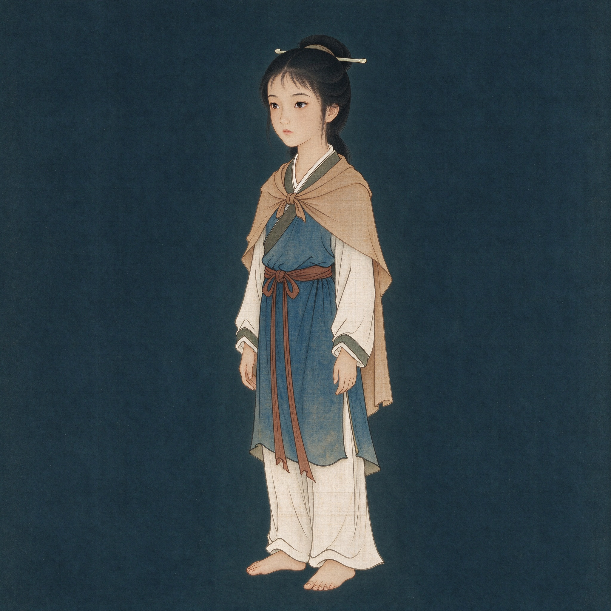
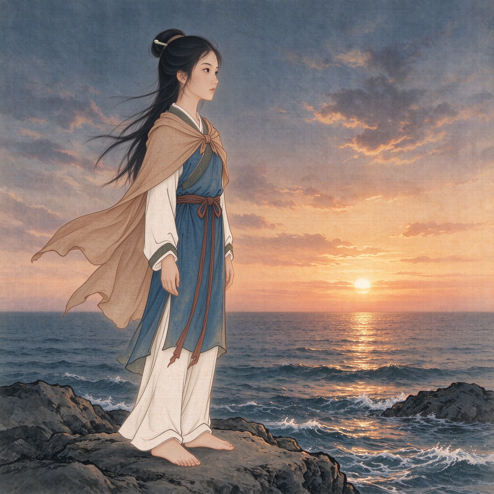
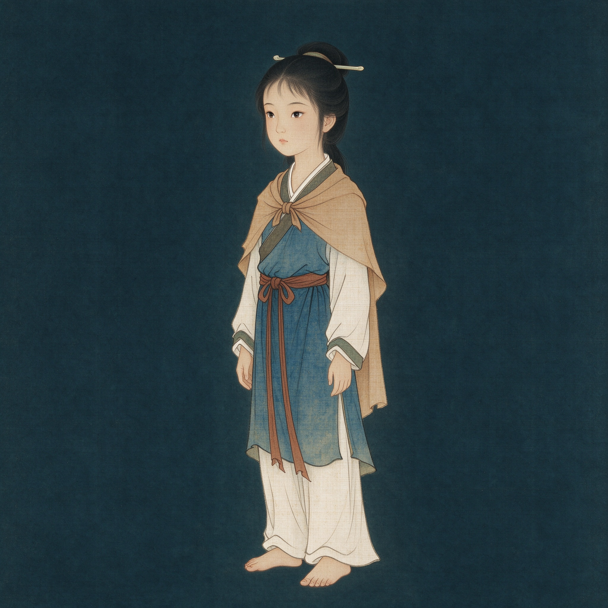
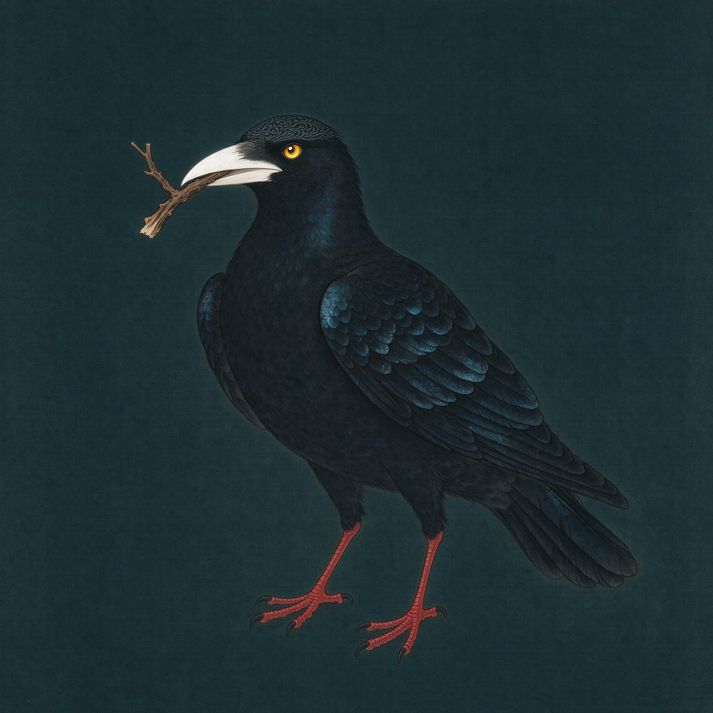

# 精卫填海 · 角色设定评审

## 结论

方向成立，可以作为后续主图的角色与风格参考。

- **女娃**：青蓝交领衣、赭色披帛、玉簪、赤足，和现有 UI 的石青/赭石/淡金色板一致。气质安静，适合第一幕。
- **精卫**：黑羽、文首、白喙、赤足、衔枝五个关键点都成立，和《山海经》原文对得上。整体像一本中国古代博物志里的神鸟，而不是普通乌鸦。

不需要重做整套风格，只需要补动作和局部强化。

## 需要调整

### 女娃

- 视觉年龄建议从现在的 10–11 岁，略微提高到 **13–15 岁**。她不是孩童，是炎帝的少女。
- 目前是静态正面偏三分之四，适合做设定，不适合直接做第一幕主图。
- 下一张需要：**侧身站在礁石上，望向东海，风吹披帛**。脸可以只露侧脸。
- 表情从“安静”再加一点“决定”：不是害怕，也不是天真。
- 保留：青蓝衣、赭色披帛、玉簪、赤足、素净配色。

### 精卫

- 文首的纹样在 2048 原图里很好看，但缩到 390px 手机宽度后容易消失。
- 需要把头顶纹样做得更明显一点，或者在纹样边缘加一线淡金/石青反光。
- 目前站立衔枝的姿态很好，但第二幕和第三幕需要**飞行姿态**：
  - 第二幕：从风暴海浪中升起，双翼展开
  - 第三幕：晨光中飞行，嘴里衔一小段柘枝
- 白喙、红足、黑羽的对比要保留。

### 文件命名

`nvwa-character.jpg` 容易和“女娲”混淆。建议后续统一改为：

```text
nvwa-girl-character.jpg
```

或：

```text
shaonv-character.jpg
```

精卫可以保持 `jingwei-character.jpg`。

## V2 评审

### 精卫 v2



**结论：可以锁定为精卫基准。**

相比 v1：

- 文首纹样终于清楚了
- 白喙、红足、黑羽、衔枝四点都在
- 体态更像神鸟，不像普通乌鸦

**唯一要调的是：**

- v2 的头顶纹样偏白、偏“蕾丝冠”，在手机上看会有点像装饰帽。
- 下一张飞行姿态里，把纹样改成**淡金/石青**的细纹，不要纯白蕾丝。
- 保留现在的白喙、红足、黑羽和眼睛。

### 女娃 v2



**结论：变化不够，暂时不要拿去生成第一幕主图。**

v2 主要是发髻更高、披帛更长，但：

- 脸还是 10–11 岁的孩童感
- 身体比例还是偏小孩
- 还是静态正面三分之四，没有“望向东海”的动作
- 表情还是安静，不够“炎帝之少女”的坚定

如果我们要的是“少女”，还需要一版 v3。  
如果接受更幼态的女娃，v2 可以用，但三幕主图都会跟着偏童书。

### 女娃 v3 Prompt

```text
Same character reference: the youngest daughter of the Fire Emperor. Ancient Chinese girl, 15 years old, late-teen proportions (about 7.5 heads tall), longer oval face, less round cheeks, defined jaw, calm resolute eyes, no makeup. Same blue cross-collar robe, ochre shawl, simple jade hairpin, barefoot. Three-quarter side view, body turned toward the East Sea, face in profile, wind lifting the shawl and hair. Standing on a rocky shore at dusk. Full body. Chinese mythological storybook illustration, mineral pigment on silk, fine ink linework, muted azurite and ochre palette. No text, no watermark, no anime, no 3D render, no childlike doll face, no sexualization.
```

负面词里加上：

```text
child, toddler, baby face, round cheeks, chibi, doll, makeup, jewelry, modern clothing, anime, 3D, text, watermark
```

### 精卫飞行姿态 Prompt

```text
Same bird reference as jingwei-character-v2: black crow-like mythical bird, patterned crown in pale gold and stone blue (not white lace), bright white beak, cinnabar red feet, holding a small zebrawood branch. Wings fully spread, rising from a stormy East Sea, dynamic flight pose, visible chest and tail. Chinese mythological storybook illustration, mineral pigment on silk, fine ink linework, cold ink-black and deep teal palette with white and cinnabar accents. 9:16, top 15% and bottom 22% simple for UI. No text, no watermark, no anime, no 3D render.
```

## 女娃 v3：通过



这一版可以锁定为女娃基准。

- 年龄终于到了 15 岁左右，不再是 10–11 岁
- 侧脸望海，有明确动作
- 风吹披帛和长发，画面有方向
- 青蓝衣、赭色披帛、玉簪、赤足都保留
- 表情安静但有决定感
- 和精卫 v2 的绢本/矿物色风格一致

**注意：v3 已经不是角色设定图，而是一张故事主图。**

它可以直接作为第一幕剧情/情绪参考，但还不是寻物背景，因为：

- 画面是 1:1，不是 9:16
- 没有小舟、贝壳、玉佩、柘叶、海鸟五个目标
- 没有布/石头两个遮挡物
- 夕阳偏橙粉，和 UI 的石青/淡金需要再统一
- 头顶接近画面上方，9:16 裁切时要给微信胶囊留空间

所以不要再画女娃角色 v4。  
下一步应该用 v3 作为角色和风格参考，生成 **9:16 第一幕主图/寻物底板**。

### 第一幕 9:16 主图 Prompt

```text
Use the provided image as exact character and style reference. The same 15-year-old ancient Chinese girl, same face, same blue cross-collar robe, ochre shawl, jade hairpin, barefoot. Vertical 9:16 Chinese mythological storybook illustration. She stands smaller on the left side of a rocky shore at dusk, seen in three-quarter profile, looking at the East Sea, wind lifting the shawl. A small wooden boat is moored on the left. Distant Mount Fajiu on the horizon. Pale moon in the upper right. Foreground across the lower half: zebrawood leaves, shells, reeds, a jade pendant resting on a piece of cloth, a seabird on a rock. The foreground is arranged so five small objects are findable but not obvious. Keep the girl's head below the top 15% UI safe zone and keep the bottom 22% free of critical objects. Mineral pigment on silk, fine ink linework, muted azurite, malachite, ochre and pale gold, less orange sunset, more stone-blue dusk. No text, no watermark, no logo, no modern objects, no anime, no 3D render.
```

### 寻物目标位置

- 左前景：小舟
- 左下：柘叶
- 中前景：贝壳（石头遮挡）
- 右中：玉佩（布遮挡）
- 右礁石：海鸟

## 当前图片





## 下一批生成 Prompt

### 第一幕主图：女娃在海边

以 `nvwa-girl-character.jpg` 作为人物参考图。

```text
Use the provided character reference exactly: a 13–15-year-old ancient Chinese girl, the youngest daughter of the Fire Emperor. Same face, same blue cross-collar robe, same ochre shawl, same jade hairpin, barefoot. She stands on a rocky shore at dusk, side profile, looking out at the East Sea, wind lifting the shawl. A small wooden boat is moored on the left. Distant Mount Fajiu on the horizon. Pale moon upper right. Foreground: zebrawood leaves, shells, reeds, a jade pendant on cloth, a seabird on a rock. Vertical 9:16, Chinese mythological storybook illustration, mineral pigment on silk, fine ink linework, muted azurite, malachite, ochre and pale gold, cinematic wide shot, subtle paper grain. Keep the top 15% and bottom 22% visually simple for UI. No text, no watermark, no logo, no modern objects, no anime, no 3D render.
```

### 第二幕主图：风暴中升起

以 `jingwei-character.jpg` 作为神鸟参考图。

```text
Use the provided bird reference exactly: a mythical black crow-like bird with a patterned crown, bright white beak and vivid cinnabar red feet. The bird rises from a violent stormy East Sea, wings spread wide, holding a small stone in its beak. Diagonal walls of dark waves, a single lightning bolt from upper left, seaweed, driftwood and broken boat planks in the foreground. Cold ink-black and deep teal palette, strong white and cinnabar accents. Vertical 9:16, Chinese mythological storybook illustration, mineral pigment on silk, fine ink linework, subtle paper grain. Keep the top 15% and bottom 22% simple for UI. No text, no watermark, no anime, no 3D render.
```

### 第三幕主图：晨光中衔枝

```text
Use the provided bird reference exactly: the same black mythical bird with patterned crown, white beak and red feet, now flying in the pale gold dawn between Mount Fajiu and the East Sea. It carries a small zebrawood branch in its beak. Left side: dark mountain slopes with zebrawood and pine. Right side: vast calm sea. Foreground: white stones, green stones, reeds. The bird is small against the enormous sea, but clearly visible. Vertical 9:16, Chinese mythological storybook illustration, mineral pigment on silk, fine ink linework, muted malachite and pale gold, quiet determined mood, large negative space of sea. Keep the top 15% and bottom 22% simple for UI. No text, no watermark, no anime, no 3D render.
```

### 物品图标

```text
A set of 15 matching game item icons for a Chinese mythological storybook game: zebrawood leaf, shell, small wooden boat, jade pendant, seabird, black feather, patterned bird head, white beak, red bird foot, grey stone, zebrawood branch, pine branch, white stone, green stone, reed. Each icon isolated on a plain dark teal background, mineral pigment and fine ink line, muted palette with pale gold accents, soft top-left light, readable at 48px. No text, no labels, no watermark, consistent style.
```

## 工具用法

- **Seedream 4.0**：用参考图生成主图和飞行姿态；强度 0.55–0.75；每张 4 个候选。
- **ChatGPT**：做局部修图、去掉背景、补全披帛/手脚、统一色调；不要让它重设计角色。
- **Photopea / Photoshop**：把人物和鸟从深色背景中扣出，处理成透明 PNG；物品图标也在这里裁切。
- **Cocos**：最终合成，不要在 AI 图里生成任何文字。

## 验收

- 女娃视觉年龄 13–15 岁
- 精卫在 390px 宽度下仍能看出文首、白喙、赤足
- 三幕主图色光递进，但五官、服装、鸟的特征一致
- 顶部 15%、底部 22% 没有关键内容
- 没有文字、水印、现代物件
- 主图 1500×2668，JPG 300–500KB
