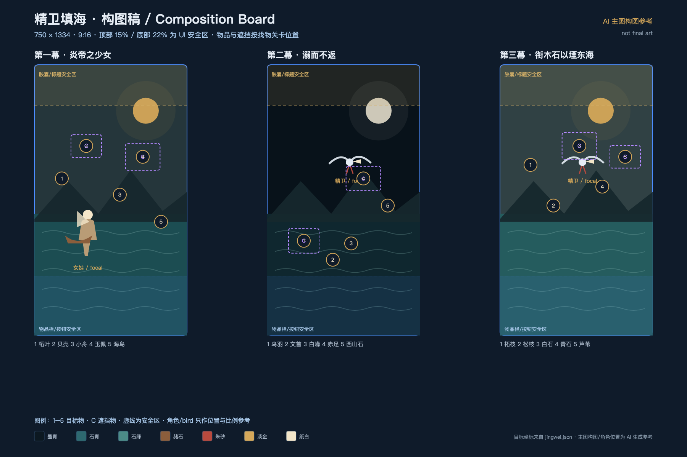

# 精卫填海 · 美术 Brief 与构图稿



> 构图稿只标注机位、安全区、目标物和遮挡物，不是最终画面。

## 1. 目标

为《解谜涨知识之山海经》第一篇《精卫填海》制作三幕主图与配套素材。

这一篇要解决的不是“把故事画出来”，而是让玩家在找物品的过程中，真的看到原文里的细节：

- 炎帝之少女
- 发鸠山多柘木
- 文首、白喙、赤足
- 其鸣自詨
- 常衔西山之木石，以堙于东海
- 精卫衔微木，将以填沧海

## 2. 美术方向

**绢本设色 + 现代绘本 + 轻电影感。**

不是红金国潮，不是二次元，不是 3D 渲染，也不是纯水墨留白。

关键词：

- 石青、石绿、赭石、朱砂、淡金
- 绢纹、纸纹、轻微颗粒
- 细墨线 + 矿物色块
- 大景深、明确光源
- 人物少而精，表情克制
- 画面里不要出现任何文字、印章、水印

## 3. 色板

| 名称 | 色值 | 用途 |
|---|---|---|
| 墨青 | `#0C1821` | 夜空、深海、阴影 |
| 石青 | `#2E6970` | 海水、远山 |
| 石绿 | `#4C8B87` | 海面、柘木叶子 |
| 赭石 | `#8B5E3C` | 山石、船木 |
| 朱砂 | `#B94A3E` | 精卫红足、关键点 |
| 淡金 | `#D5A85A` | 月光、UI 呼应 |
| 纸白 | `#F3E6C9` | 女娃衣襟、白喙 |

## 4. 角色设定

### 女娃

- 炎帝的小女儿，视觉年龄 12–14 岁
- 古代中国少女，不是现代童装
- 素色交领长衣，外披浅赭色短披
- 发间一支简单玉簪
- 赤足或草鞋，站在海边
- 表情：安静、好奇，有一点不属于孩子的坚决
- 不做性感化处理，不做夸张大眼二次元

### 精卫

- 体型像乌鸦，但比普通乌鸦更有神性
- 黑羽，带一点石青反光
- 头顶有细密纹样（文首）
- 白喙（白喙）
- 红足（赤足）
- 嘴里常衔一小段柘木或石子
- 眼睛是整张图里最亮的点之一
- 必须和普通乌鸦区分开：纹首、白喙、红足三处要清楚

## 5. 三幕色光

| 幕 | 场景 | 光 | 主色 |
|---|---|---|---|
| 第一幕 | 东海之滨 | 黄昏转月光，平静 | 石青、淡金、赭石 |
| 第二幕 | 风暴化鸟 | 冷光、闪电、压迫 | 墨青、冷蓝、白、朱砂 |
| 第三幕 | 衔木石填海 | 晨曦，海面变亮 | 石绿、淡金、纸白 |

## 6. 画面规格

- 设计画布：750 × 1334
- 输出：1500 × 2668（2x）
- 构图比例：9:16
- 格式：JPG（背景）/ PNG（透明素材）
- 背景单张目标：300–500KB
- 顶部 0–15%：微信胶囊和标题安全区
- 底部 0–22%：物品栏/按钮安全区
- 中间 63%：主要视觉和寻物区域

寻物目标不要放在顶部或底部安全区。

## 7. 三幕构图

### 第一幕：炎帝之少女

**画面**

- 黄昏的东海之滨
- 远处发鸠山轮廓
- 海面平静，月光从右上落下
- 女娃站在左侧礁石上，望向海
- 左侧浅滩有一只小舟
- 前景有柘木枝叶、贝壳、芦苇
- 右侧礁石上停着一只海鸟
- 玉佩放在一块布上，贝壳半埋在石下

**五个目标**

1. 柘叶
2. 贝壳（石头遮挡）
3. 小舟
4. 玉佩（布遮挡）
5. 海鸟

**遮挡**

- 石头 → 贝壳
- 布 → 玉佩

**焦点**

女娃的侧脸 + 远处月光 + 海面反光。

### 第二幕：溺而不返

**画面**

- 风暴中的东海
- 斜向浪墙，闪电从左上劈下
- 海面中央，一只黑鸟从浪里升起
- 黑羽、纹首、白喙、红足要清楚
- 鸟的脚边有一块从西山衔来的石头
- 海草、浮木、碎舟板散在画面里

**五个目标**

1. 乌羽（海草遮挡）
2. 文首
3. 白喙
4. 赤足（浮木遮挡）
5. 西山石

**遮挡**

- 海草 → 乌羽
- 浮木 → 赤足

**焦点**

白喙和红足，和黑色风暴形成强对比。

### 第三幕：衔木石以堙东海

**画面**

- 晨曦，东海与西山之间
- 左侧是发鸠山/西山，柘木与松枝
- 右侧是仍然辽阔的东海
- 精卫在画面中央偏上，嘴里衔着一小段柘枝
- 海面有它投下的影子
- 前景是白石、青石、芦苇

**五个目标**

1. 柘枝
2. 松枝
3. 白石（布遮挡）
4. 青石
5. 芦苇（石头遮挡）

**遮挡**

- 布 → 白石
- 石头 → 芦苇

**焦点**

精卫嘴里那一小段木枝与整片东海的体量对比。

## 8. 资产清单

### 背景

- `jingwei-act1-bg` 1500×2668
- `jingwei-act2-bg` 1500×2668
- `jingwei-act3-bg` 1500×2668

同一张背景用于剧情裁切和寻物全景。

### 物品图标

15 个透明 PNG，256×256 或 512×512：

`leaf`, `shell`, `boat`, `jade`, `bird`, `feather`, `head`, `beak`, `foot`, `stone`, `zhe`, `pine`, `white-stone`, `green-stone`, `reed`

图标需要和背景画风一致，不要做成扁平 UI 图标。

### 遮挡物

6 个透明 PNG，512×512：

- 布（2 种）
- 石头（2 种）
- 海草
- 浮木

### UI

- 篇卡裁切图
- 幕卡裁切图
- 分享卡背景（后续）

## 9. AI 生图流程

建议组合使用：

- **Seedream 4.0**：主图、东方审美、高分辨率、图生图一致性
- **ChatGPT 图像生成/编辑**：构图修正、去文字、补全、局部重绘、图标变体
- **Photopea / Photoshop**：裁切、分层、抠图、统一色调
- **Cocos**：最终合成、UI、动效

不要指望一张图直接出成品。正确流程是：

```text
角色设定图
→ 第一幕主图
→ 第一幕寻物裁切
→ 第二幕（以第一幕为风格参考）
→ 第三幕
→ 物品图标
→ 遮挡物
→ 统一色 grading
→ 接入 Cocos
```

## 10. Seedream / ChatGPT Prompt

### 女娃角色设定

```text
Full-body character sheet of a 13-year-old ancient Chinese girl, the youngest daughter of the Fire Emperor. Simple linen cross-collar robe in muted teal and ochre, a pale jade hairpin, barefoot, calm determined expression. She looks like a character from a Chinese mythological storybook, not anime, not modern fashion. Three-quarter view, neutral standing pose, plain dark teal background, soft studio light, fine ink linework, mineral pigment texture, restrained color palette. Full body visible, no text, no watermark, no logo.
```

### 精卫角色设定

```text
Mythical black bird inspired by the Chinese Classic of Mountains and Seas. Body like a crow, subtle azurite sheen on black feathers, delicate patterned crown on its head, bright white beak, vivid cinnabar red feet, holding a small broken branch in its beak. Elegant, determined, slightly sacred. Chinese storybook illustration, fine ink lines, mineral pigment on silk, dark teal background, no text, no watermark.
```

### 第一幕主图

```text
Vertical 9:16 Chinese mythological storybook illustration. Calm East Sea at dusk, layered ink and mineral pigments, azurite blue, malachite green, ochre and muted gold. A 13-year-old ancient Chinese girl in a simple linen robe and jade hairpin stands on a rocky shore at lower left, looking at the sea. A small wooden boat is moored on the left. Distant mountain Fajiu on the horizon. A pale moon upper right. Foreground: zebrawood leaves, shells, reeds, a jade pendant resting on a piece of cloth, a seabird on a rock. Cinematic wide shot, silk paper texture, subtle grain, deep atmospheric perspective. Keep the top 15% and bottom 22% visually simple for UI. No text, no letters, no watermark, no modern objects, no anime, no 3D render.
```

### 第二幕主图

```text
Vertical 9:16 Chinese mythological storybook illustration, same visual style and palette as the previous scene. A violent storm over the East Sea, diagonal walls of dark waves, a single lightning bolt from upper left. At the center, a mythical black bird rises from the waves: crow-like body, patterned crown, bright white beak, vivid red feet, holding a stone. Seaweed, driftwood and broken boat planks in the foreground. Cold ink-black and deep teal palette with white and cinnabar accents. Strong contrast on the white beak and red feet. Keep the top 15% and bottom 22% simple for UI. No text, no watermark, no anime, no 3D render.
```

### 第三幕主图

```text
Vertical 9:16 Chinese mythological storybook illustration, same style. Dawn between Mount Fajiu and the East Sea. On the left, dark mountain slopes with zebrawood and pine branches; on the right, a vast calm sea under pale gold light. At center, the black mythical bird with patterned crown, white beak and red feet carries a small branch. White stones, green stones and reeds in the foreground. Mineral pigment on silk, subtle paper grain, quiet but determined mood, large negative space of sea. Keep the top 15% and bottom 22% simple for UI. No text, no watermark, no anime, no 3D render.
```

### 物品图标

```text
A set of 15 matching game item icons for a Chinese mythological storybook game: zebrawood leaf, shell, small wooden boat, jade pendant, seabird, black feather, patterned bird head, white beak, red bird foot, grey stone, zebrawood branch, pine branch, white stone, green stone, reed. Each icon on a plain dark teal background, mineral pigment and fine ink line, muted palette with gold accents, soft top-left light, readable at small size. No text, no labels, no watermark, consistent style, game asset sheet.
```

### 负面 Prompt

```text
text, letters, Chinese characters, logo, watermark, signature, modern clothing, anime, manga, 3D render, photorealistic, plastic skin, sexualized child, gore, blood, extra limbs, deformed hands, extra birds, collage, frame, border, UI elements, buttons, icons with text
```

## 11. 一致性技巧

1. 先只定女娃和精卫，不要同时生成三幕。
2. 固定 seed 或使用第一幕作为风格参考。
3. 三幕使用同一组色板关键词。
4. 每张图生成 4 个版本，只选构图最接近的。
5. 不在图里生成文字；所有文字由 Cocos 渲染。
6. 寻物目标单独生成图标，不直接画死在背景里。
7. 背景里只保留“目标所在的位置”，物品由 Cocos 叠加，方便点击和遮挡。

## 12. 验收标准

- 390px 宽手机屏幕上，女娃和精卫一眼可辨
- 精卫的白喙、红足、纹首三处细节成立
- 寻物目标不靠文字也能认出
- 顶部 15% 和底部 22% 没有关键内容
- 没有文字、水印、现代物件
- 三幕色光有递进，但属于同一世界观
- 单张背景不超过 500KB
- 第一幕主图能同时承担剧情页和寻物页

## 13. 商用注意

使用 Seedream / ChatGPT 生成图时，先确认对应平台对商业游戏的使用条款。保留生成记录和原图，方便后续修改与版权说明。
