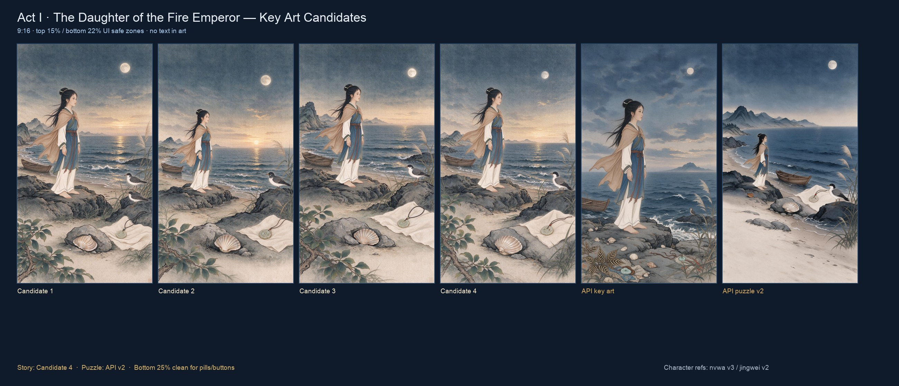
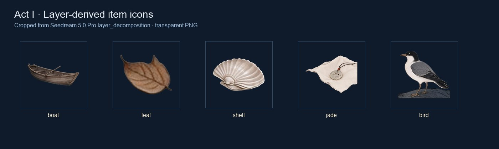

# Act 1–3 场景图评审

## 当前选择

| 幕 | 剧情/寻物共用图 | 说明 |
|---|---|---|
| 第一幕 | `act1-puzzle-plate-v2-...jpg` | 女娃缩小，五个目标在中间带，底部 25% 留空 |
| 第一幕剧情 | `act1-candidate-4.jpg` | 女娃更大，夕阳和海岸叙事完整 |
| 第二幕 | `act2-puzzle-plate-v2-...jpg` | 风暴神鸟，羽/首/喙/足/石，底部留空 |
| 第三幕 | `act3-puzzle-plate-v2-...jpg` | 晨光衔枝，木石/芦苇，底部留空 |
| 物品图标 | `items/*.png` | 从第一幕 layer_decomposition 裁切 |
| 备用 | `act1-key-art-...jpg` | Seedream API 第一张，石青黄昏 |





## 图层分解

Seedream 5.0 Pro 的 `layer_decomposition: true` 已跑通，返回了：

```text
z0 底图
z1 Sea water
z2 Shore rocks
z3 Wooden boat
z4 Ancient style girl
z5 Dry leaf
z6 Shell
z7 Jade pendant on cloth
z8 Seabird
z9 Reeds
```

每个非底层带 `z_index`、`name`、`description`、`bounding_box`，透明 PNG。

原始图层单张 2–8MB，总计约 38MB，没有进 Git。保留：

- `items/boat.png`
- `items/leaf.png`
- `items/shell.png`
- `items/jade.png`
- `items/bird.png`
- `act1-layer-map.json`

## 目标坐标

第一幕坐标来自 layer bounding box；第二、三幕按最终画面重新量过：

- 第一幕：叶、贝壳、小舟、玉佩、海鸟
- 第二幕：乌羽、文首、白喙、赤足、西山石
- 第三幕：柘枝、松枝、白石、青石、芦苇

## 已知问题

- 第二幕文首/白喙/西山石距离近，点击热区偏紧。
- 第三幕白石、青石靠近底部物品栏。
- 第二、三幕物品栏图标仍是矢量 fallback。
- 遮挡物是 Cocos 画的布/石头，不是 AI 图层。

## 下一步

1. 真机验证分包下载和底部安全区
2. 第二、三幕也做 layer_decomposition，替换 fallback 图标
3. 用 AI 生成布/石头遮挡物
4. 再开始《夸父逐日》或《后羿射日》
