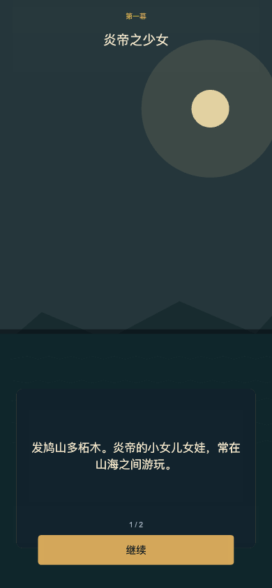

# 《解谜涨知识之山海经》第一篇：精卫填海



## 一句话

炎帝的小女儿女娃溺于东海，化为精卫鸟。她不再离开，而是日复一日衔来西山的木石，要把东海填平。

## 原文

> 发鸠之山，其上多柘木。有鸟焉，其状如乌，文首、白喙、赤足，名曰精卫，其鸣自詨。是炎帝之少女，名曰女娃。女娃游于东海，溺而不返，故为精卫，常衔西山之木石，以堙于东海。
>
> ——《山海经·北山经》

## 结构

```text
卷：山海经
篇：精卫填海
幕一：炎帝之少女
幕二：溺而不返
幕三：衔木石以堙东海
```

首版三幕暂用“寻物”验证叙事、关卡、存档和知识卡流程；不是因为精卫只能做寻物。正式版第一、三幕将替换为找不同，第二幕保留寻物。

---

## 第一幕：炎帝之少女

### 剧情页 1

> 发鸠山多柘木。  
> 炎帝的小女儿女娃，常在山海之间游玩。

### 剧情页 2

> 那一天，她独自去了东海。  
> 海面很静，静得连风都停了。

### 谜题

**岸边寻物**

潮水退去，找出女娃留在岸边的五样东西：

- 柘叶
- 贝壳
- 小舟
- 玉佩
- 海鸟

### 小笺

> **炎帝之少女**  
> “少女”在这里是最小的女儿，不是现代汉语里“年轻女孩”的意思。

> **发鸠山**  
> 原文说“其上多柘木”。柘木是精卫故事里最早出现的物象之一。

---

## 第二幕：溺而不返

### 剧情页 1

> 风浪骤起。  
> 女娃沉入东海，再也没有回来。

### 剧情页 2

> 海面飞起一只鸟：状如乌，文首、白喙、赤足。  
> 它叫起来，像在喊自己的名字——精卫。

### 谜题

**风暴寻踪**

在风暴后的海边，找出精卫化形后的五处特征：

- 乌羽
- 文首
- 白喙
- 赤足
- 西山石

### 小笺

> **文首、白喙、赤足**  
> 精卫不是普通的鸟。原文给了它三个非常具体的形象特征。

> **其鸣自詨**  
> 它的叫声像在呼唤自己的名字，“精卫”因此得名。

---

## 第三幕：衔木石以堙东海

### 剧情页 1

> 精卫没有离开。  
> 它从西山衔来木枝和石子，一次次飞向东海。

### 剧情页 2

> 海很大，木石很小。  
> 可它没有停下。

### 谜题

**衔石填海**

找出精卫衔来的五种木石：

- 柘枝
- 松枝
- 白石
- 青石
- 芦苇

### 小笺

> **常**  
> “常衔西山之木石”的“常”，不是一次，而是日复一日。

> **堙**  
> “堙”是填塞、堵塞。精卫想做的，是把整个东海填平。

> **陶渊明**  
> “精卫衔微木，将以填沧海。”  
> 一根小木，面对整个沧海，这就是精卫填海。

---

## 篇末：山海小笺

### 原文

> 发鸠之山，其上多柘木。有鸟焉，其状如乌，文首、白喙、赤足，名曰精卫，其鸣自詨。是炎帝之少女，名曰女娃。女娃游于东海，溺而不返，故为精卫，常衔西山之木石，以堙于东海。

### 白话

> 发鸠山多柘木。山中有一种鸟，形状像乌鸦，头上有花纹，白喙，红足，名叫精卫，叫声像在喊自己的名字。它本是炎帝的小女儿女娃。女娃去东海游玩，溺水未归，化为精卫。此后，它常常衔来西山的木石，填塞东海。

### 成语

> **精卫填海**  
> 比喻意志坚决、不畏艰难，明知力量微小仍坚持去做。

### 后世

> 陶渊明《读山海经·其十》  
> “精卫衔微木，将以填沧海。”

---

## 数据字段

```json
{
  "id": "jingwei",
  "title": "精卫填海",
  "source": "《山海经·北山经》",
  "acts": [
    {
      "id": "act1",
      "title": "炎帝之少女",
      "pages": ["...", "..."],
      "knowledge": ["...", "..."],
      "puzzle": {
        "type": "hidden",
        "prompt": "...",
        "targets": [
          { "id": "leaf", "name": "柘叶", "x": 0.2, "y": 0.6, "hint": "..." }
        ]
      }
    }
  ]
}
```
