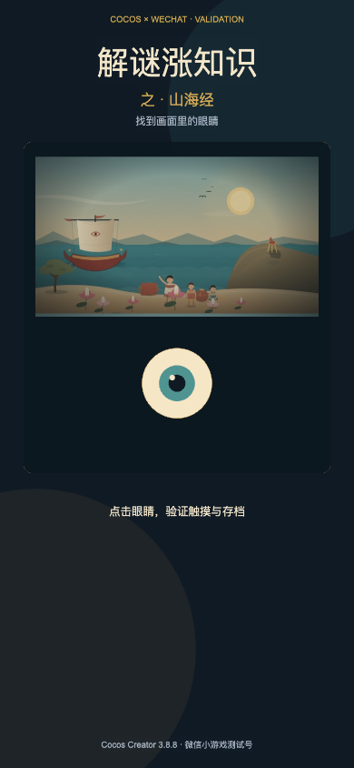
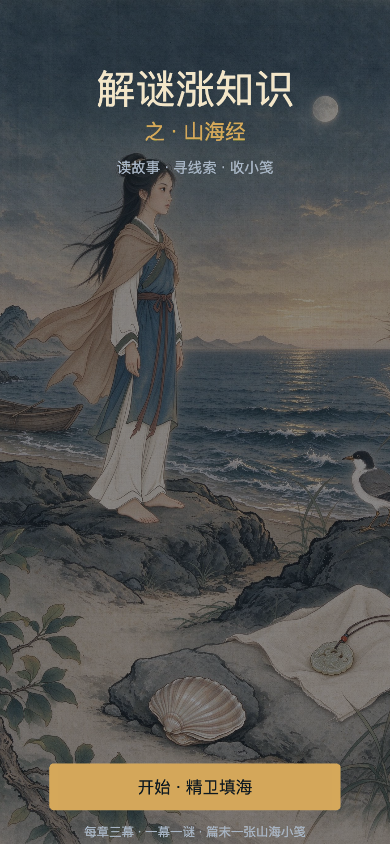
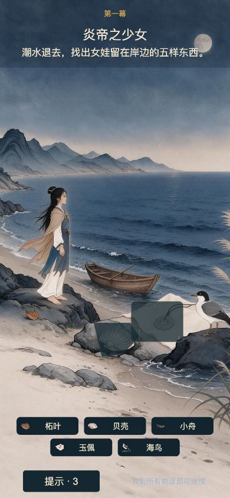
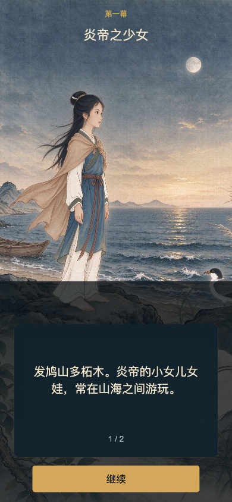
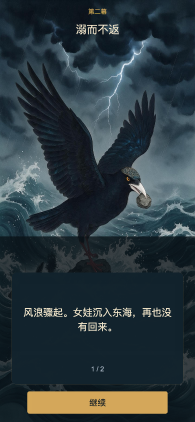
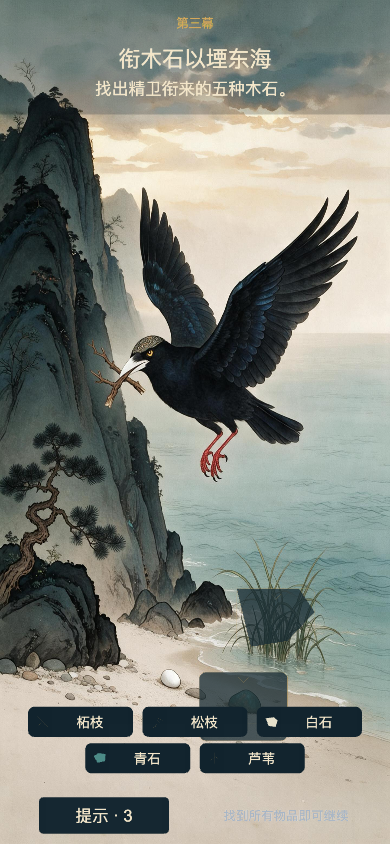
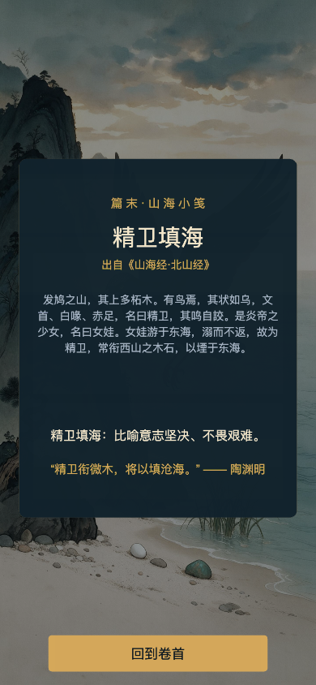

# WeChat Mini Game — Cocos Validation Spike

Project name: **解谜涨知识**  
First release: **解谜涨知识之山海经**



## Short answer

You do **not** need a registered Mini Game AppID or a completed filing to start the Cocos validation spike.

WeChat DevTools provides a **test account** ("测试号"). It supports local development, device preview and most APIs; it cannot verify monetization or upload/release. Use it for the first Cocos build.

Start account registration and filing in parallel, not as a blocker.

## Required tools

1. **Cocos Creator 3.8 LTS** (or current 3.8.x)
   - https://www.cocos.com/creator-download
2. **WeChat DevTools — Stable**
   - https://developers.weixin.qq.com/miniprogram/dev/devtools/download.html
3. A free Cocos account for the Dashboard.

Cocos Creator and WeChat DevTools are free. There is no activation code for the validation spike.

## What the test account can do

Official WeChat docs describe the test account as usable before AppID registration. It supports normal development and preview; it cannot validate commercial capabilities or upload/release.

Reference:
- https://developers.weixin.qq.com/minigame/dev/guide/develop/start.md

## Start in parallel

Create the Mini Game account and reserve the name as soon as possible:

- Registration: https://mp.weixin.qq.com/wxopen/waregister?action=step1
- Choose the **game** category; after choosing a game category the account becomes a Mini Game account.
- Prefer the **casual** category. Do not choose **文化互动** unless you are certain: it is irreversible, has restrictions, and is not available to individual subjects.
- For the first version use **IAA (ad-only) / no virtual payment**. This avoids payment qualifications and the version-number path, but **Mini Game filing and Mini Program filing are still required**.
- If the game name contains English, WeChat may request a software copyright certificate. Keep the Mini Game name pure Chinese.

References:
- Registration flow: https://developers.weixin.qq.com/minigame/introduction/guide/register.html
- Categories: https://developers.weixin.qq.com/minigame/introduction/guide/type.html
- IAA guide: https://developers.weixin.qq.com/minigame/introduction/guide/iaa.html
- IAA qualification: https://developers.weixin.qq.com/minigame/introduction/guide/zzsh-iaa.html
- Mini Game filing: https://developers.weixin.qq.com/minigame/introduction/guide/nrjs.html

Filing is slow: platform review is typically 1–2 working days, and the authority review is typically 10–20 working days. Budget 1–2 months overall.

## Cocos spike scope

Use a separate project folder, not the existing Phaser app.

Actual path:

```text
wechat-minigame/
  assets/
    resources/spike.jpg
    scenes/Spike.scene
    scripts/SpikeController.ts
  settings/
  package.json
```

Validation scene:

- Portrait 750 × 1334 design resolution; safe-area aware
- One background image (a converted lotus or cyclops scene is fine)
- One tappable difference / hidden object
- Correct tap: toast + counter
- Wrong tap: small shake / toast
- Chinese heading: `解谜涨知识` / `之 · 山海经`
- Save a flag with `wx.setStorageSync` and read it back
- One simple sound effect, optional
- Build target: WeChat Mini Game
- Import the generated `build/wechatgame` folder into WeChat DevTools
- Use the test account AppID, then scan the preview QR code

Do not add ads, sharing, cloud save or the full story yet.

## Success criteria

- Build opens in WeChat DevTools without errors
- Preview QR opens on at least one iPhone and one Android phone
- Touch hit detection is accurate on both
- Chinese text is legible; no missing glyph boxes
- Storage write/read survives a relaunch
- Main package is under 4 MB; total package under 30 MB
- No obvious frame drops on a mid-range Android phone
- No dependency on the Poki SDK

## After the spike

1. Register the real AppID and enter it in Cocos build settings.
2. Start the IAA qualification and Mini Game filing.
3. Build one full chapter: three story pages + one puzzle.
4. Add the WeChat reward-ad adapter and test with a real ad unit only after Traffic Master is available.
5. Then expand to five chapters.

## Three-act chapter prototype

The first real chapter flow is now implemented:

```text
Title
→ Chapter card: 精卫填海
→ Act 1 card: 炎帝之少女
→ 2 story pages
→ 5-target search
→ 山海小笺
→ Act 2 card: 溺而不返
→ 2 story pages
→ 5-target search
→ 山海小笺
→ Act 3 card: 衔木石以堙东海
→ 2 story pages
→ 5-target search
→ 山海小笺
→ 篇末山海小笺
```

Verified in the Cocos web-mobile build at 390 × 844. All three acts complete, auto cards work, the 5/5 completion timer advances, and the final knowledge card opens.

The chapter now uses final-direction AI artwork for all three acts:

- Act 1 story: `act1-story.jpg`
- Act 1 puzzle: `act1-puzzle.jpg`
- Act 2: `act2.jpg`
- Act 3: `act3.jpg`

The first-act target icons were cut from Seedream 5.0 Pro `layer_decomposition`; the remaining acts use the existing vector fallback icons. The target hit zones are now mapped to full-screen art coordinates rather than the old programmatic scene area.

### UI / puzzle pass

- All text sizes were increased again: story body 38, knowledge body 30, ending source 26, prompt 32, pills 26, secondary labels 24–28, buttons 32.
- The title banner `COCOS × WECHAT` was removed.
- Bottom layout now uses `safeArea.bottom` from `wx.getWindowInfo()`; story buttons, puzzle pills, hint button, knowledge button and ending button are lifted above the Android navigation bar.
- The `COCOS × WECHAT` banner was removed.
- Puzzle targets no longer show text in the scene; they show only icons.
- The target names now sit in rounded pills at the bottom. Found targets gain a `✓` prefix and gold text.
- Two covers per act hide selected targets. Tapping a cover animates it away and reveals the icon.
- The hint system prioritises covered targets and tells the player to move the cover first.
- Chapter and act cards now stay for 3.0 s and 2.4 s; tapping skips.
- The three-act prototype currently uses the same hidden-object mechanic in every act. This is a prototype choice, not a story constraint; spot-the-difference is the next puzzle-type addition.













### Chapter asset bundle / WeChat subpackage

The chapter art is in a separate Cocos Asset Bundle:

```text
assets/bundles/chapter-jingwei/
  act1-story.jpg
  act1-puzzle.jpg
  act2.jpg
  act3.jpg
  items/*.png
```

Build result:

- Main package: **3.51 MB**
- Chapter subpackage: **2.34 MB**
- Total: **5.85 MB**

`tools/art/patch-wechat-build.mjs` adds the WeChat subpackage entry to the built `game.json` and patches AppID/project name. Run it after every WeChat build.

The runtime calls `wx.loadSubpackage({ name: 'chapter-jingwei' })` before `assetManager.loadBundle`, so the first entry shows the "正在展开山海卷……" progress screen.

### Known limitations in this pass

- Act 2 and Act 3 target hit zones are tight and some objects sit close to the bottom pill bar.
- Act 2/3 pill icons are vector fallbacks, not AI cutouts.
- Covers are still Cocos-drawn cloth/rock shapes rather than painted cover art.
- Real-device validation is still required for the subpackage download and the Android safe area.


### WeChat build workflow (important)

The build order is:

```text
1. Cocos Creator builds the WeChat game
2. Terminal runs the post-build patch
3. WeChat DevTools imports build/wechatgame and previews
```

The build template `wechat-minigame/build-templates/wechatgame/game.json` now writes the `chapter-jingwei` subpackage automatically on every Cocos build. A rebuild will no longer silently drop it.

The patch step is only needed to restore the real AppID, add the WeChat-required `game.js` stub to the asset-only subpackage, and verify the output. It is **not** run inside WeChat DevTools. DevTools only opens the built folder; it does not regenerate Cocos asset bundles.

WeChat requires a `game.js` entry inside every subpackage, even when the subpackage only contains Cocos Asset Bundle assets. The template and patch script add:

```text
build/wechatgame/assets/chapter-jingwei/game.js
```

Without it, DevTools reports:

```text
未找到 ["subpackages"][0]["root"] 对应的 /assets/chapter-jingwei/game.js 文件
```

If building from Cocos Creator's GUI:

```bash
cd /Users/sam/AgentSharedProjects/tales-n-puzzles
node tools/art/patch-wechat-build.mjs
```

Or use the one-command terminal build:

```bash
cd /Users/sam/AgentSharedProjects/tales-n-puzzles
./tools/art/build-wechat.sh          # debug
./tools/art/build-wechat.sh release  # release
```

Then import:

```text
/Users/sam/AgentSharedProjects/tales-n-puzzles/wechat-minigame/build/wechatgame
```

Why the patch is needed:

- Cocos outputs `assets/chapter-jingwei/` but does not automatically put it in WeChat `subpackages`.
- The patch adds the `chapter-jingwei` subpackage entry to `game.json`.
- It also restores the real AppID/project name in `project.config.json`.

After a WeChat DevTools "编译", you do **not** need to run it again. It is only for a new Cocos build.

### Aspect handling

The chapter art is 9:16 (1440×2560), but WeChat phones render at a taller visible design size (for example 750×1666). Forcing the sprite to 750×1666 stretched the figures vertically.

The background now uses **aspect-fill / cover**:

```text
scale = max(screenWidth / imageWidth, screenHeight / imageHeight)
displayWidth = imageWidth * scale
displayHeight = imageHeight * scale
```

The sprite is slightly wider than the screen and is clipped at the two sides; the image is never stretched. Puzzle hit zones use the same displayed width/height, so target positions stay aligned.

Trade-off: on tall phones a little of the left/right edge is cropped. If that becomes a problem, switch `artDisplaySize` to `min(...)` (contain/letterbox) and add a background color or title bar above/below the art.

## Current machine status

Installed and verified:

- Cocos Creator **3.8.8** at `/Applications/Cocos/Creator/3.8.8`
- WeChat DevTools at `/Applications/wechatwebdevtools.app`
- Cocos project: `wechat-minigame/`
- WeChat build: `wechat-minigame/build/wechatgame/`
- Cocos AppID set to `wx9f31155e9d70c411`
- 2D-only engine trim: **3.5 MB** main package

Validation performed:

- Cocos web-mobile build runs at 390 × 844
- Chinese title and body render correctly
- Clean lotus artwork loads from the `resources` bundle
- Eye target receives touch and updates the status label
- `sys.localStorage` survives the write; value is `found`
- No missing-class or runtime errors after the scene class ID fix

Real-device run (Android, WeChat base library 3.18.0):

- Cocos Creator 3.8.8 launched successfully
- Scene loaded: `db://assets/scenes/Spike.scene`
- Visible design size: 750 × 1666
- Lotus artwork loaded from the resources bundle
- Eye target taps logged 13 times in a row
- No missing-class, JavaScript exception, or scene-load failure

Non-blocking warnings in the device log:

- `Failed to set shading scale, pipelineSceneData is invalid` — Cocos legacy-pipeline warning from the trimmed 2D build; rendering continues.
- `Read json failed: ... cacheList.json` — first-launch asset cache file is absent; normal.
- `webapi_game_transfer -31001` / `getUserGrantInfo fail` — WeChat's game-transfer/benefit service, not this game's code.
- `preload traffic expt` — WeChat ad-system experiment plumbing; no ad SDK is used in the spike yet.

## Storage finding

Two Android sessions were compared:

- `console-1794377232187.log` — first session, 13 eye taps
- `console-1794377864410.log` — second session, 19 eye taps

The first two sessions logged `previous: ""` at startup. Core touch and image loading still worked, but `sys.localStorage` did not provide a reliable readback across debug sessions.

The third session (`console-1794379241000.log`, 14:40) was built with the native API and logged:

```text
[Spike] Cocos WeChat validation started {previous: "", ...}
[Spike] wx storage write found
[Spike] eye tapped 1
```

The native write/readback works inside the session. A follow-up phone screenshot showed `上次已找到，再点一次试试`, which means `previous === "found"` on a later launch; cross-session persistence is confirmed.

The phone screenshot also exposed the WeChat capsule overlapping the centered title. The spike now reads `wx.getMenuButtonBoundingClientRect()` (with `getWindowInfo`/`getSystemInfoSync`) and shifts the header and card below the capsule. It also lifts the footer above the bottom system UI. The device log now includes a `[Spike] safe top` entry.

The spike now uses the native WeChat API explicitly:

```ts
wx.setStorageSync(STORAGE_KEY, 'found');
wx.getStorageSync(STORAGE_KEY);
```

It falls back to `sys.localStorage` only when `wx` is unavailable (web preview). New log lines:

```text
[Spike] wx storage write found
[Spike] Cocos WeChat validation started { previous: "found", ... }
```

Still pending:

- Re-run the WeChat build visually and confirm the title/card now sit below the capsule
- Test on iOS
- Replace the debug build with a release build before submission

The first build exposed two Cocos-specific issues that are now fixed:

1. The scene must reference the compiler-generated class ID `3f2a1tMXW5PcIqbDB0uP0pb`, not the ordinary compressed asset UUID.
2. The image is a `Texture2D` subasset; load `spike/texture` and create a `SpriteFrame` at runtime.
